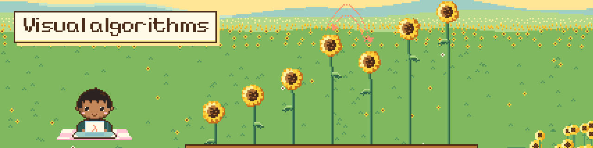
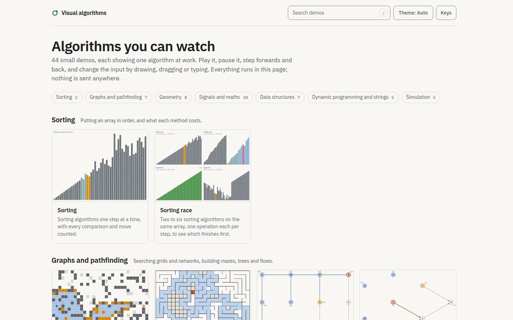

<p align="center"></p>

# Visual algorithms

44 interactive algorithm demos: sorting, pathfinding, geometry, Fourier epicycles, fluids. TypeScript and canvas.

[Live demo](https://varunagarwalofficial.github.io/visual-algorithms/) · [MIT licence](LICENSE)



The idea is the one the first three demos had: do not show an algorithm's
answer, show it working. Every demo can be played, paused, stepped forwards and
backwards and slowed down, counts the work it does, and takes input you can
draw, drag, type or randomise.

## At a glance

- **44 demos in seven sections**, live at the link above, with no runtime
  dependencies.
- A demo's settings and input live in the URL, so a link reproduces exactly
  what is on screen.
- 107 unit tests over the algorithm code, and a smoke test that loads every
  demo in a headless browser.

**Stack:** TypeScript and canvas, built with Vite, tested with Vitest, deployed
to GitHub Pages.

## The demos

| Section                         | Demos                                                                                                                                                                                                                                                                                |
| ------------------------------- | ------------------------------------------------------------------------------------------------------------------------------------------------------------------------------------------------------------------------------------------------------------------------------------ |
| Sorting                         | Sorting (12 algorithms; bars, dots or colour wheel; optional sound), Sorting race                                                                                                                                                                                                    |
| Graphs and pathfinding          | Grid pathfinding (BFS, DFS, Dijkstra, A*, greedy, bidirectional, jump point search), Maze generation (backtracker, Prim, Kruskal, Wilson), Breadth-first and depth-first search, Topological sort, Strongly connected components, Minimum spanning tree, Maximum flow (Edmonds-Karp) |
| Geometry                        | Convex hull, Delaunay and Voronoi, Segment intersections (sweep line), Closest pair, Bezier and B-spline curves, Quadtree, Marching squares, Metaballs                                                                                                                               |
| Signals and maths               | Fourier epicycles, Fast Fourier transform, Convolution, L-systems, Perlin and simplex noise, Mandelbrot and Julia sets, Newton fractal, Reaction-diffusion, Game of Life, Elementary cellular automata                                                                               |
| Data structures                 | Binary heap, Binary search trees (plain, AVL, red-black), B-tree, Trie, Union-find, Hash table, Skip list                                                                                                                                                                            |
| Dynamic programming and strings | Edit distance, Longest common subsequence, Knapsack, String matching (KMP, Z), Huffman coding                                                                                                                                                                                        |
| Simulation                      | Boids, N-body gravity (Barnes-Hut), Elastic collisions (spatial hash), Cloth (Verlet), Stable fluids                                                                                                                                                                                 |

Each demo page carries its own short explanation and the formula that matters.
The three original ideas are described below.

## Using it

- The home page groups the demos by section; the search box filters them, and
  on a demo page it is a jump menu.
- A demo's settings and input are kept in the URL, so "Copy link" shares
  exactly what is on screen.
- Keys: `/` search, Space or `K` play/pause, arrows or `.` `,` step and back,
  `R` reset, `[` `]` slower and faster, `N` `P` next and previous demo, `H`
  home, `?` the list.
- Light or dark follows the system.
- A link reproduces a simulation on any screen: boids, collisions and cloth run
  in a fixed 800 × 600 world that is scaled to fit. Painted walls, drawn cells
  and cloth cuts are in the link. Things done by hand to a running simulation
  (dragging cloth, flinging a disc, stirring the fluid) are not, and each of
  those demos says so.
- An address that names no demo shows a not-found page with near matches;
  `404.html` does the same job for a static host.

## How it is built

Algorithms that proceed in steps run once and record a trace: a list of small
events (compare, swap, visit a cell, rotate at a node). Playback is a cursor
moving through that list, which is what makes pause, single-step, step back,
scrubbing and exact counters simple. Simulations advance in time instead and
keep a short history of snapshots for stepping back. `src/ui/player.ts` holds
both kinds of playback.

## The three original ideas

### Fourier epicycles

Sample a closed outline at N evenly spaced points and read each point as a
complex number `z_n = x_n + i·y_n`. The discrete Fourier transform gives one
coefficient per frequency:

```
c_k = (1/N) · Σ_n  z_n · e^(−2πi·k·n/N)
```

Each coefficient is a rotating vector: `|c_k|` is its radius, `arg(c_k)` its
starting angle, and `k` the number of turns it makes per lap. Adding them tip to
tail gives the pen position:

```
z(t) = Σ_k  c_k · e^(2πi·k·t),   0 ≤ t < 1
```

Two details matter. Bins above N/2 are treated as negative frequencies
(`k − N`); they agree at the sample points but only the slow rotation is smooth
in between. And the circles are sorted by radius, so the first m of them are the
best m-circle approximation in the least-squares sense. You can pick a preset,
load an SVG (all its shapes, with their transforms), or draw a shape, then change how many circles are used.

### Metaballs with marching squares

Each ball adds to a scalar field that falls off with distance:

```
f(x, y) = Σ_i  r_i² / ((x − x_i)² + (y − y_i)²)
```

The surface is the contour `f = 1`. One ball alone gives exactly its own circle;
nearby balls add up, so the contour bulges and merges.

Marching squares finds that contour by sampling `f` only at the corners of a
grid. Each cell's four corners are inside or outside, which makes a 4-bit case
index, and a 16-entry table says which cell edges the contour crosses. Two cases
are ambiguous (diagonal corners inside); the average of the four corners decides
whether they join. The crossing point on an edge between corner values `a` and
`b` is found by linear interpolation, `t = (1 − a) / (b − a)`. The demo lets you
turn that off to see the midpoint-only version, change the cell size, and show
the grid, the inside corners and the underlying field. An adaptive option
samples on a quadtree instead: a cell is split only where its corners or centre
disagree, and the outline is followed from cell to cell, so most of the empty
and full area is never sampled.

### Sorting

Each algorithm records `compare(i, j)`, `swap(i, j)`, `write(i, value)` or
`read(i)` steps. Comparisons, swaps and writes are counted separately: the O(n²)
sorts differ mostly in how many swaps they make, merge sort makes none because
it copies values back from a buffer, and counting and radix sort never compare
at all.

## The look

The pages use the owner's site look, "Editorial". Its tokens are in
`src/styles/c-editorial-tokens.css`, copied unchanged from the website; the
fonts it names (Newsreader for text and canvas labels, IBM Plex Mono for code,
CM Web Serif for mathematics) and their licences are in `public/fonts`.
`src/style.css` maps this project's own variables onto those tokens and adds
nothing of its own beyond layout: page and ink colours in light and dark, the
type sizes (17, 20, 22, 28 and 44 px, 36 px on a phone), spacing, measure,
rules and the focus ring. The light or dark scheme follows the system. There
are no shadows, gradients, coloured panels or badges; regions are separated by
space and the rule colour. The one filled control on a page is its first
action; other buttons are outlined, and a switched-on toggle gets a heavier
outline rather than a fill.

Canvas colours come from the same file through `src/ui/theme.ts`, and mean the
same thing in every demo (and in the other five tools restyled with it):

| Role in the code | Meaning                                             | Site token                |
| ---------------- | --------------------------------------------------- | ------------------------- |
| compare          | being read or compared                              | `--site-mean-measured`    |
| change           | being written, moved, swapped or rejected           | `--site-mean-against`     |
| good             | finished, found, or part of the answer              | `--site-mean-proved`      |
| accent           | the current item or frontier                        | `--site-mean-open`        |
| visit            | already explored: a grey tint, not a meaning colour | muted mixed into the page |

Where a picture used to draw more than four colours, it now uses these four
and tells the rest apart by shape, pattern, position or a label: the group
colours (`series`) are cut from six to four, the Z-box in string matching is
drawn in the ink, start and goal in pathfinding are ink discs with their
letters, and the ranges in the sorting picture are all drawn in the muted ink
with their names. All five colours, the text and the muted text meet WCAG AA
(4.5:1) against the page in both schemes; the visited tint is a background
area at about 1.5:1 and is always named in the legend.

What the new typeface moved: labels in pictures are never under 17 px, so value
labels on narrow sorting bars alternate between two rows, the caption on the
sorting canvas wraps onto more lines instead of being squeezed, point numbers
in the geometry demos take the first free spot around their point, the index
row under array cells is taller, and AVL balance labels sit on a patch of the
page so edges do not cross them. On a phone the catalogue is one column, with
each picture above its text.

Canvases are sized from the device-pixel box, so lines stay sharp on high-DPI
screens and when the browser zoom changes.

## Run it

Needs Node 22.13 or newer (an even-numbered release; the workflow uses 22).

```
npm install
npm run dev        # development server
npm run build      # type-check and build to dist/
npm run preview    # serve the build
```

## Test and lint

```
npm test           # Vitest: a handful of tests per algorithm family
npm run lint       # ESLint, Prettier check and tsc
npm run format     # apply Prettier
npm run smoke      # loads every demo in a headless browser (needs agent-browser
                   # and `npm run preview` running); fails on any page error
```

The home page thumbnails in `public/thumbs` are screenshots of the demos
themselves. After changing how a demo looks, remake them with
`scripts/thumbnails.sh http://localhost:5173` while `npm run dev` is running
(needs agent-browser and ImageMagick).

## Layout

```
src/core/      pure algorithm code and its tests; no DOM
  sorting/ graphs/ geometry/ marching/ fourier/ signals/ fractals/
  automata/ structures/ strings/ sim/
  random.ts    seeded random numbers, so a seed in the URL reproduces an input
  encode.ts    compact encodings of points and cells for the URL
src/demos/     one folder per section, one module per demo, loaded on demand
  registry.ts  the sections; each folder's index.ts lists its demos
  layout.ts    the shared page skeleton
src/ui/        canvas sizing, playback, URL state, pointer input, controls, theme
src/main.ts    router, search and keyboard shortcuts
src/home.ts    the index page and the not-found page
src/styles/    the site's look tokens, copied unchanged from the website
public/        favicon, 404.html, preview image, thumbnails, fonts and licences
```

An ESLint rule keeps `src/core` from importing UI code or touching browser
globals.

## Accessibility

All controls are native form elements and work from the keyboard. Colours follow
the system light or dark scheme. With
`prefers-reduced-motion`, the animated demos start paused on a complete frame
and can be advanced with Step or Play. Drawing and dragging on a canvas need a
pointer; presets, typed input and Randomise do not. The layout works down to
phone width, where controls are 44 px tall and the playback buttons come first
in the panel, under the canvas and its counters. Text and control borders meet WCAG AA contrast in both themes,
and every focusable element shows a focus ring.

## Deploying

`.github/workflows/pages.yml` builds `dist/` and publishes it to
<https://varunagarwalofficial.github.io/visual-algorithms/> on every push to
`main`.

## Credits

Grown from a rebuild of three hobby projects written between 2020 and 2022: a sorting
visualiser (2020), metaballs with marching squares and a Fourier transform
visualiser (both 2022, Python/Pygame and p5.js; see
[Marching-Squares-Metaballs](https://github.com/VarunAgarwalOfficial/Marching-Squares-Metaballs) and
[Fourier-Transform-Visualizer](https://github.com/VarunAgarwalOfficial/Fourier-Transform-Visualizer)). The smiley preset is the test
drawing from the original Fourier project.

## Status

Working, as of 26 November 2026. See [STATUS.md](STATUS.md).

## Licence

MIT. See [LICENSE](LICENSE).
